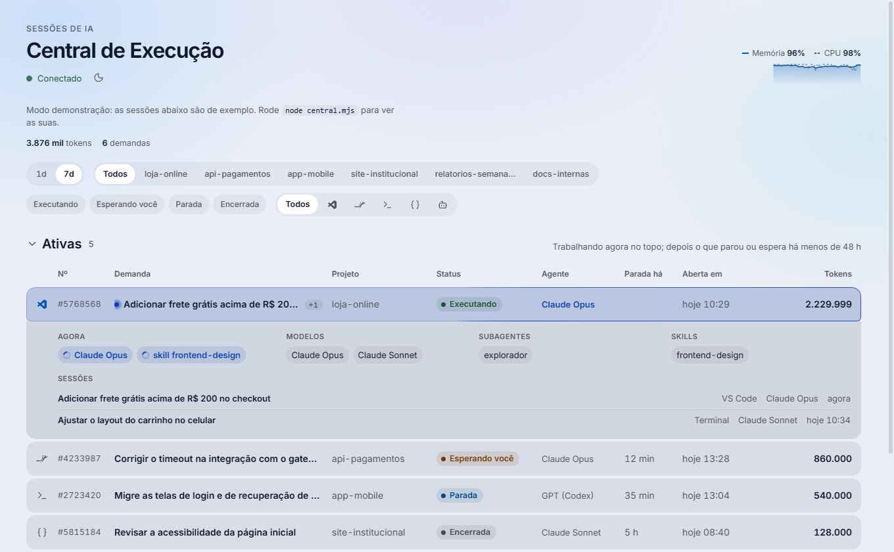
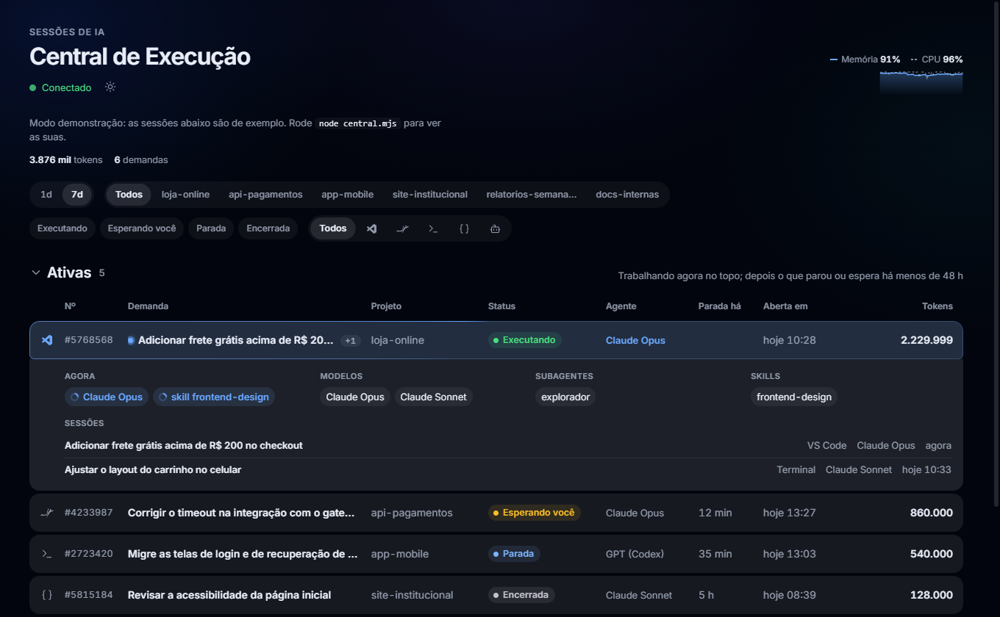

# Central de Execução

Painel local que mostra **todas as suas sessões de IA num lugar só**: o que cada uma está fazendo, onde foi aberta (terminal, VS Code, Orca, automação), qual modelo usa, quantos tokens gastou, se está trabalhando, parada ou **esperando uma resposta sua**, agrupadas por tema.

É **a mesma tela** que o autor usa no painel dele em produção (mesmo visual, layout, tipografia, cores, ícones, animações e modo claro e escuro), alimentada aqui pelos registros das sessões da sua própria máquina.





- **Só Node 18+ para rodar:** sem `npm install`, sem dependências. A tela já vem construída na pasta `dist/`.
- **Sem rede:** lê os registros que o Claude Code e o Codex já gravam no seu PC e abre uma página em `http://127.0.0.1:4555`. Nada sai da sua máquina.
- **Funciona em qualquer estrutura:** Windows, macOS e Linux, uma pasta ou vinte projetos, com ou sem worktrees.

Quer ver a tela antes de ter sessões, ou mostrá-la a alguém sem expor as suas? `node central.mjs --demo` abre com sessões de exemplo.

## O que aparece

| Item | De onde vem |
|---|---|
| **Demanda** | Um **tema** (ver abaixo): todas as sessões dele numa linha só. O título é o da sessão mais ativa; o `+N` diz quantas sessões a mais ele tem |
| **Onde roda** (ícone) | Terminal, VS Code, JetBrains, Orca, Claude Desktop, Web, Nuvem, SDK ou automação (`entrypoint` do Claude Code, `originator` do Codex) |
| **Status** | **Executando** (escreveu nos últimos 3 min), **Esperando você** (a última fala terminou com pergunta), **Parada** (até 60 min) e **Encerrada** (mais que isso) |
| **Agente** | Claude (com a família do modelo: Opus, Sonnet, Haiku, Fable) ou GPT (Codex) |
| **Parada há** | Tempo desde o último registro da demanda |
| **Onde parou** | O fim da última resposta (quando está esperando você, a pergunta que ela fez) |
| **Aberta em** | Quando a primeira sessão do tema começou |
| **Tokens** | Tokens novos medidos: entrada + saída + escrita no cache, somando as sessões do tema (inclui os subagentes). A leitura do cache fica de fora, porque é a parte que quase não pesa |
| **Nº** | Um número fixo, calculado a partir do nome do tema, para você citar a demanda ("a #4829130 parou") |
| **Memória e CPU** | O gráfico da última hora, amostrado pelo próprio servidor a cada 5 s |

Clique numa linha para abrir o detalhe: quem trabalha agora, os modelos, os subagentes e as skills que passaram, e uma linha por sessão. Clique no cabeçalho de uma coluna para ordenar. Os filtros do topo (período, projeto, status e onde roda) rodam no navegador. A demanda que está trabalhando de verdade fica sempre no topo, realçada. A página se atualiza sozinha a cada 5 s e **só mostra o que existe**: o que o registro não tem fica vazio, nada é estimado.

## Instalar e abrir

**Pelo Claude Code ou pelo Codex** (o jeito mais fácil), escreva na conversa:

```
Clone https://github.com/viniciuscamp0s/central-de-execucao, rode node central.mjs e abra http://127.0.0.1:4555 no meu navegador.
```

**Ou no terminal:**

```bash
git clone https://github.com/viniciuscamp0s/central-de-execucao.git
cd central-de-execucao
node central.mjs
```

Abra `http://127.0.0.1:4555`. Outras opções:

| Comando | O que faz |
|---|---|
| `node central.mjs --demo` | Sessões de exemplo (pasta `exemplos/`), sem ler as suas |
| `node central.mjs --porta 5000` | Outra porta |
| `node central.mjs --horas 720` | Janela de leitura (padrão 168 h, 7 dias). O filtro de período acompanha: 1d, 7d e 30d |
| `node central.mjs --json` | Imprime o retrato em JSON e sai |

A primeira leitura percorre os registros inteiros (alguns segundos para dezenas de sessões; um gigabyte de registros leva cerca de 10 s). Depois, cada leitura só olha o que cresceu desde a anterior.

### Para o seu agente usar

`node central.mjs --json` imprime o retrato inteiro (sessões, temas, contagens) e sai. O seu Claude Code pode rodar isso antes de responder "o que está em andamento?" e enxergar as outras sessões abertas, inclusive as de outras ferramentas. Com o painel aberto, `http://127.0.0.1:4555/api/demandas` entrega a lista que a tela usa.

## Adaptar à sua estrutura

Copie `central.config.example.json` para `central.config.json` (na mesma pasta) ou para `~/.central-de-execucao.json`:

- **`temas`**: agrupe sessões da mesma demanda por palavras (`"palavras": ["crm", "pipeline"]`) ou regex, procurando no título, no pedido ou na pasta. A primeira regra que bater vence; sem regra, o tema é o projeto (a raiz do repositório, juntando as worktrees dele).
- **`interfaces`**: dê nome a um `entrypoint` ou `originator` próprio (ele ganha o ícone genérico de aplicativo).
- **`ativaMinutos` / `paradaMinutos`**: os limites dos estados. **`ativaAgoraSegundos`**: por quanto tempo depois de escrever a linha fica realçada.
- **`mostrarSubagentes`**: `true` mostra também as sessões filhas como linhas (por padrão os tokens delas somam na sessão que as chamou).
- **`horas`** e **`porta`**: os mesmos das opções de linha de comando.

O Claude Code respeita `CLAUDE_CONFIG_DIR` e o Codex respeita `CODEX_HOME`, se você mudou essas pastas.

### Plugar outra ferramenta

Cada ferramenta é um adaptador em `central.mjs` (`claudeCode`, `codex`). Para Gemini CLI, Aider ou outra: escreva uma função que leia os registros dela e devolva sessões no formato de `sessao()`, e acrescente em `ADAPTADORES`. Peça ao seu Claude Code: *"crie um adaptador para a ferramenta X na Central de Execução"*.

## A tela e como reconstruí-la

A tela é uma aplicação React + TypeScript (Vite) na pasta `web/`, e o resultado já construído mora em `dist/` (é o que o `central.mjs` serve). Só precisa reconstruir quem mexer na tela:

```bash
npm run build      # instala as dependências de web/ e gera ../dist
```

Para mexer com recarga ao vivo: `node central.mjs` num terminal e `npm run dev` dentro de `web/` em outro (a API é encaminhada para a porta 4555).

## Privacidade

O servidor escuta só em `127.0.0.1` e recusa pedido cujo endereço não seja o local (um site aberto no seu navegador não consegue ler a sua lista). A página não carrega nada de fora: nem fonte, nem script. O texto das sessões (título, pedido, fim da resposta) aparece só na sua tela; o JSON omite o caminho dos arquivos de registro. No modo `--demo`, nada da sua máquina é lido.

## Créditos

MIT. Criado por [viniciuscamp0s_](https://github.com/viniciuscamp0s). A fonte é a [Inter](https://rsms.me/inter/) (SIL OFL) e os ícones de traço são do [Lucide](https://lucide.dev) (ISC); os logotipos do Orca e do VS Code são das marcas deles e aparecem só para identificar a interface.
